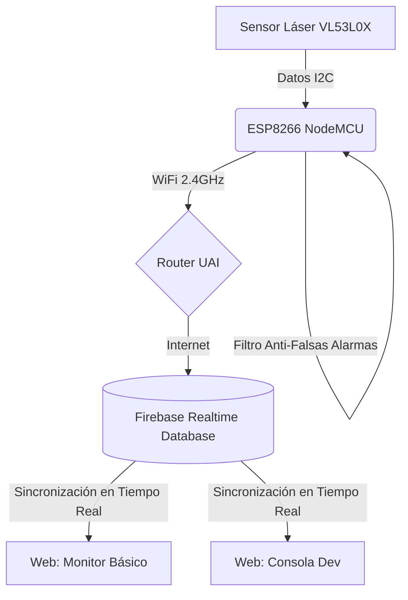

# Software - Documentación
**Última edición:** 28 de octubre de 2026

## Contenido
Esta carpeta contiene todo el código y documentación del software del sistema automatizado de monitoreo de estacionamientos de la Universidad Adolfo Ibáñez.

### 📁 Carpetas

#### `src/`
Código fuente del proyecto en sus distintas versiones e iteraciones (.ino para ESP8266). Incluye pruebas básicas, diagnósticos, versiones con Deep Sleep y conexión WPA2-Enterprise.

#### `librerias/`
Librerías adicionales necesarias (no incluidas por defecto en Arduino IDE).

#### `docs/`
Documentación técnica detallada del software, manuales operativos y diagramas de flujo.

---

## Stack Tecnológico

**Plataforma:** Microcontrolador ESP8266 (NodeMCU)  
**Lenguaje:** C/C++  
**IDE:** Arduino IDE 2.x  
**Base de Datos:** Firebase Realtime Database  
**Librerías principales:**
- `ESP8266WiFi` - Gestión de red y conectividad.
- `FirebaseESP8266` - Conexión directa con la base de datos en la nube.
- `Wire` - Comunicación I2C.
- `Adafruit_VL53L0X` - Control del sensor láser de tiempo de vuelo.
- `wpa2_enterprise.h` - Autenticación en la red universitaria (UAI Alumnos).

---

## Instalación y Configuración

### 1. Instalar Arduino IDE
Descargar e instalar la última versión de Arduino IDE desde el sitio oficial (arduino.cc).

### 2. Configurar Placa ESP8266
1. Ir a **Archivo > Preferencias**.
2. En "Gestor de URLs Adicionales de Tarjetas", agregar: `http://arduino.esp8266.com/stable/package_esp8266com_index.json`
3. Ir a **Herramientas > Placa > Gestor de tarjetas**, buscar "ESP8266" e instalar el paquete de la comunidad.

### 3. Instalar Librerías
Para instalar las librerías personalizadas de este proyecto en Windows:
1. Copia el contenido que está dentro de la carpeta `software/librerias/` de este repositorio.
2. Pégalo en la carpeta de librerías de Arduino de tu computador, que normalmente está en: `C:\Usuarios\TuUsuario\Documentos\Arduino\libraries`.
*(Alternativamente, puedes usar el Gestor de Librerías del Arduino IDE para buscar e instalar `Firebase ESP8266 Client` y `Adafruit_VL53L0X`).*

### 4. Cargar Código
1. Abrir el archivo `.ino` correspondiente desde la carpeta `src/`.
2. Seleccionar la placa "NodeMCU 1.0 (ESP-12E Module)" y el puerto COM correcto.
3. Compilar y subir.

---

## Configuración de Parámetros

Editar las siguientes constantes en el código principal (`.ino`) según el entorno de despliegue. **Nota de seguridad:** Nunca subas tus claves reales al repositorio, usa variables de entorno o archivos ignorados.

```cpp
// Credenciales WiFi (Red estándar o WPA2-Enterprise)
#define WIFI_SSID      "UAI Alumnos"
#define WIFI_USER      "usuario@alumnos.uai.cl" // Solo si usas la red Enterprise
#define WIFI_PASSWORD  "tu_clave"

// Credenciales Firebase
#define FIREBASE_HOST  "estacionamiento-uai-default-rtdb.firebaseio.com"
#define FIREBASE_AUTH  "tu_secreto_firebase"

// Configuración de Hardware y Lógica
#define PIN_SDA D2
#define PIN_SCL D1
#define UMBRAL_MM 500             // Distancia máxima para considerar ocupado (50 cm)
#define INTERVALO_LECTURA_MS 1000 // Frecuencia de medición
#define RUTA_SENSOR "/sensor_1"   // Nodo en Firebase
```

---

## Arquitectura del Software

A continuación se muestra el diagrama de flujo de datos del sistema:



### Módulos Principales
1. **Inicialización (Setup):** Despertar del microcontrolador, validación de memoria RTC (en versiones Deep Sleep), arranque del I2C, conexión de red WiFi y autenticación en Firebase.
2. **Lectura de Sensores:** Captura de distancia en milímetros mediante el sensor láser VL53L0X.
3. **Procesamiento y Filtro:** Evaluación de los datos crudos. Implementa un sistema de validación por repetición (ej. 4 lecturas positivas seguidas) para descartar falsos positivos como peatones cruzando.
4. **Comunicación:** Construcción del objeto JSON y envío mediante `updateNode` hacia Firebase. Incluye latido de estado (uptime, rssi).
5. **Gestión de Energía:** Rutina de Deep Sleep en la versión de bajo consumo, guardando estados en la memoria RTC para minimizar el uso de la antena WiFi.

---

## Estructura de Datos (Firebase)

El sistema no utiliza una API REST tradicional de "peticiones", sino sincronización en tiempo real vía Firebase. La estructura JSON del nodo de cada sensor es la siguiente:

| Ruta | Tipo | Descripción |
|----------|--------|-------------|
| `estado` | String | "OCUPADO" o "LIBRE" |
| `distancia_mm` | Int | Última medición válida del láser (-1 si está fuera de rango) |
| `rssi` | Int | Potencia de la señal WiFi del microcontrolador |
| `cambio_s` | Int | Timestamp (en segundos) del último cambio de estado |
| `latido` | Int | Contador incremental para verificar que el sensor sigue en línea |